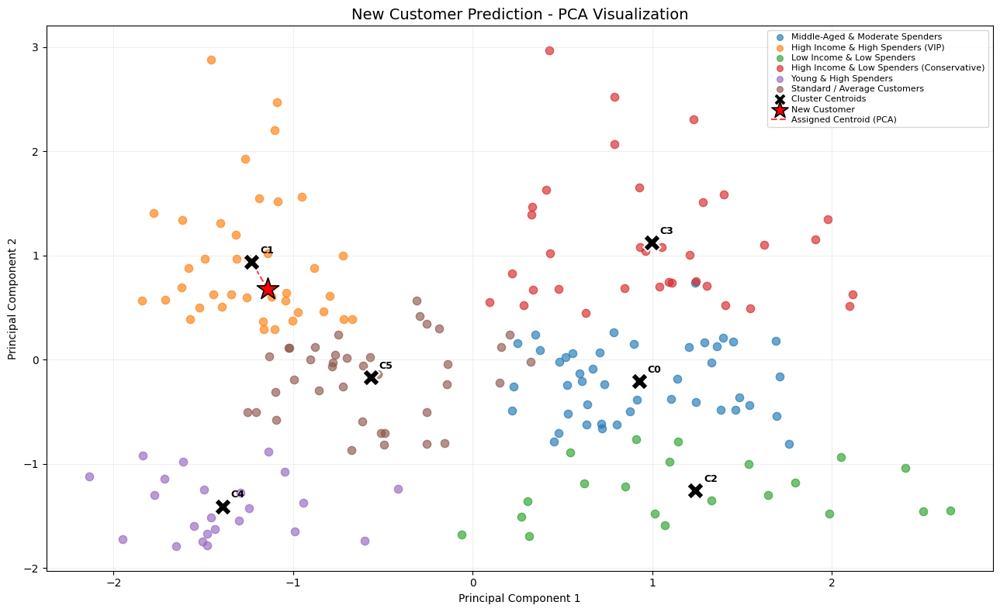
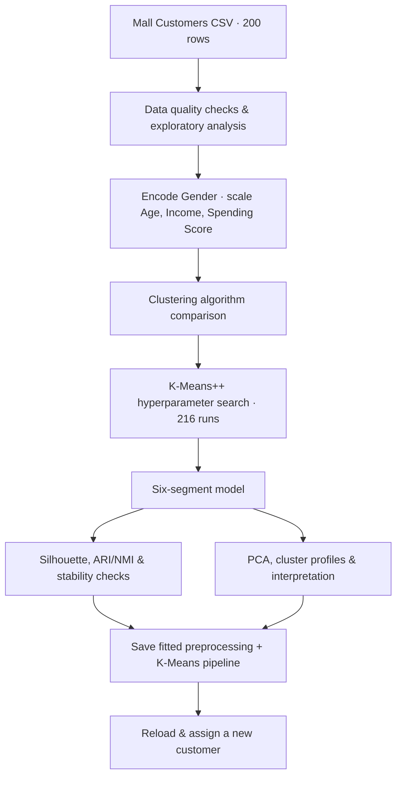
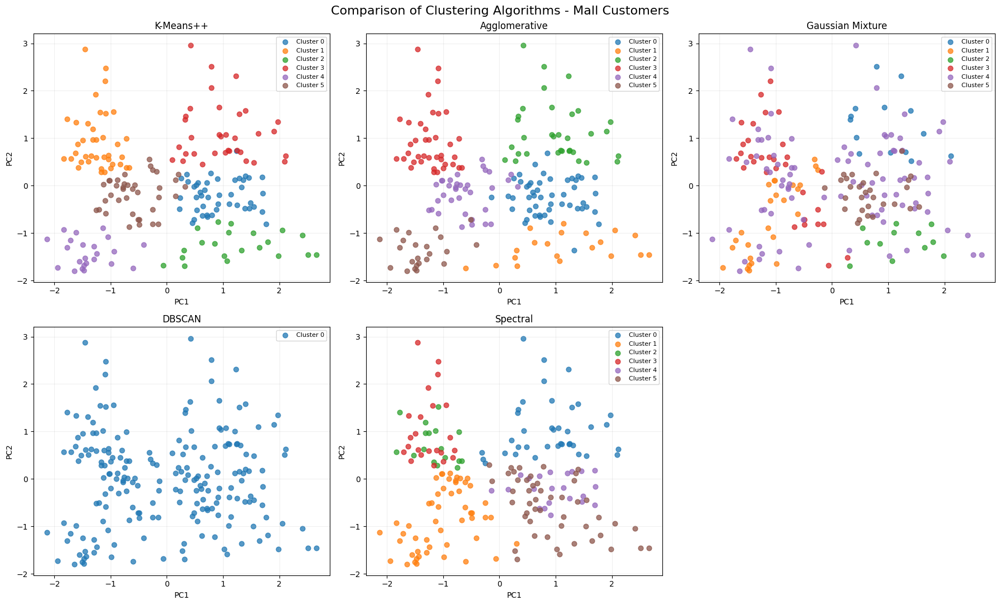
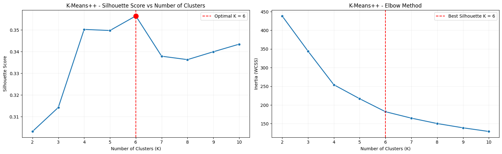
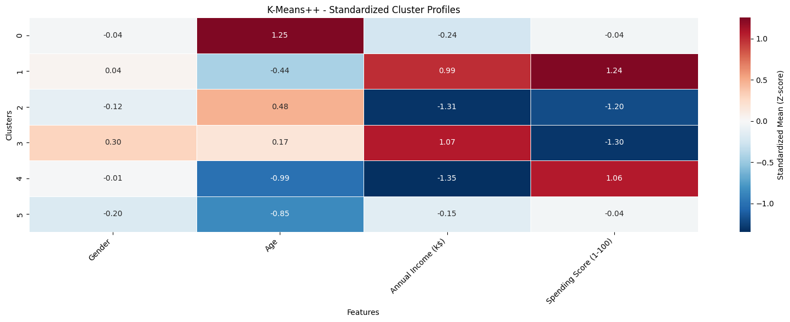
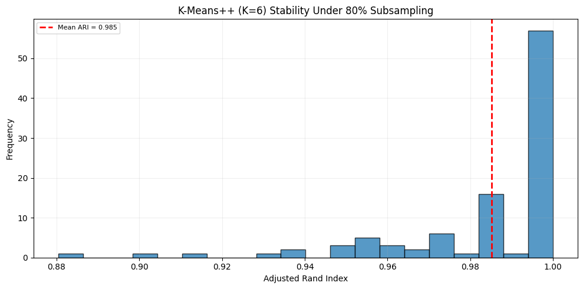

<div align="center">

# 🛍️ Mall Customer Segmentation

### Exploring customer behavior with unsupervised learning

**K-Means++ · Model comparison · Stability analysis · Interpretable segments · New-customer inference**


**200 customers** · **6 segments** · **0.3565 silhouette** · **0.9851 subsampling ARI**

</div>

---

## 🔎 Overview

This project segments mall customers using demographic and spending-related attributes, without relying on predefined customer classes. It follows an end-to-end exploratory clustering workflow: data inspection, feature preprocessing, model selection, hyperparameter tuning, stability testing, cluster interpretation, and inference on a new customer.

The selected **K-Means++ model** identifies **six customer segments**. The segmentation is reasonably stable across the experiments performed, although a silhouette score of **0.3565** indicates **moderate**, not perfect, cluster separation. The project is an **exploratory portfolio analysis**, not a validated production marketing system.

<p align="center">
  
</p>

<p align="center"><sub>Customer segments in the two-component PCA projection. Black X markers represent cluster centroids; the red star is a new customer. Clustering itself takes place in the four-feature transformed space.</sub></p>

## 📊 Results at a glance

| Metric | Result |
|:--|--:|
| Dataset size | **200** customers |
| Features used | **4** |
| Final clustering algorithm | **K-Means++** |
| Selected number of clusters | **6** |
| Silhouette score | **0.3565** |
| Davies–Bouldin index ↓ | **1.0051** |
| Calinski–Harabasz score ↑ | **99.6549** |
| K-Means inertia (WCSS) | **181.9514** |
| Coverage | **100%** |
| Initialization stability (mean ARI) | **1.0000** |
| 80% subsampling stability (mean ARI) | **0.9851** |
| First two PCA components — variance explained | **71.77%** |

> **Reading the metrics:** higher silhouette/Calinski–Harabasz and lower Davies–Bouldin are generally favorable, but these indices measure different aspects of a partition. High stability does **not** imply strong separation, ground-truth accuracy, or proven business value.

## 🧭 Analytical workflow



## 📦 Dataset & preprocessing

**Dataset:** [Mall Customer Segmentation Data (Kaggle)](https://www.kaggle.com/datasets/vjchoudhary7/customer-segmentation-tutorial-in-python)

| Original column | Treatment |
|:--|:--|
| `CustomerID` | Dropped: identifier, not a customer characteristic |
| `Gender` | Encoded as `Female = 0`, `Male = 1`; **not** standardized |
| `Age` | StandardScaler |
| `Annual Income (k$)` | StandardScaler |
| `Spending Score (1-100)` | StandardScaler |

**Checks in the notebook:** 0 missing values, 0 duplicate records, and 2 observations flagged by the 1.5×IQR rule across the numerical features. The flagged observations are **not automatically removed**.

> Gender is treated as a 0/1 numerical feature in a Euclidean distance metric. This is a modeling choice rather than an inherently correct representation. The effect of including it should be tested before real-world use.

## 🧪 Choosing the clustering model

Five algorithms were compared on the same transformed data. The partition-based methods were configured for six groups; DBSCAN discovered its number of groups from local density.

| Algorithm | Clusters | Silhouette ↑ | Davies–Bouldin ↓ | Calinski–Harabasz ↑ |
|:--|--:|--:|--:|--:|
| **K-Means++** | **6** | **0.356** | **1.005** | **99.655** |
| Agglomerative (Ward) | 6 | 0.350 | 1.009 | 95.258 |
| Spectral | 6 | 0.249 | 1.387 | 70.431 |
| Gaussian Mixture | 6 | 0.041 | 1.644 | 21.869 |
| DBSCAN (`eps=2.2`, `min_samples=5`) | 1 | N/A | N/A | N/A |

DBSCAN assigned all observations to a **single** cluster, so the three cluster-validity metrics are undefined for that result—not zero. K-Means++ achieved the strongest internal clustering indices in this particular experiment. **Agglomerative was a close competitor** rather than a clear loser.

<p align="center"></p>

### Hyperparameter search

The K-Means++ grid evaluated **216 combinations**:

- `n_clusters`: 2–10
- `n_init`: 10, 20, 30, 50
- `max_iter`: 300, 500, 1000
- `tol`: `1e-3`, `1e-4`
- Initialization: `k-means++`; fixed seed: `42`

The best displayed configuration is `k=6`, `n_init=10`, `max_iter=300`, `tol=0.001` (silhouette **0.3565**). Multiple configurations converge to the same partition. Although six clusters rank highest on silhouette, **four and five clusters are close** (about **0.350** each), so the business interpretability of the extra segments matters.



## 👥 Meet the six segments

The following are **descriptive labels**, assigned after inspecting the cluster means. They are not ground-truth categories.

| Cluster | Segment label | Customers | Avg. age | Avg. annual income (k$) | Avg. spending score |
|--:|:--|--:|--:|--:|--:|
| **0** | Middle-Aged & Moderate Spenders | 45 | 56.33 | 54.27 | 49.07 |
| **1** | High Income & High Spenders (VIP) | 39 | 32.69 | 86.54 | 82.13 |
| **2** | Low Income & Low Spenders | 21 | 45.52 | 26.29 | 19.38 |
| **3** | High Income & Low Spenders (Conservative) | 34 | 41.26 | 88.50 | 16.76 |
| **4** | Young & High Spenders | 23 | 25.00 | 25.26 | 77.61 |
| **5** | Standard / Average Customers | 38 | 27.00 | 56.66 | 49.13 |

**Interpretation notes:** Cluster 1 combines high income and high spending scores; Cluster 3 has similarly high average income but a substantially lower spending score. Cluster 4 shows relatively low income alongside high spending scores. Cluster 0 has an average age of **56.33**, so the notebook's *“Middle-Aged”* label should be revisited before presenting it as a formal customer persona.

### Cluster profiles



The heatmap shows **standardized cluster-level means (z-scores)**, while the table above reports the original age/income/spending units. The first two principal components explain **71.77%** of the transformed-data variance, so a two-dimensional PCA chart is useful for exploration but omits some information.

## 🔬 Robustness and agreement

| Experiment | Design | Result |
|:--|:--|:--|
| Initialization stability | 100 random seeds, 4,950 pairwise ARI comparisons | Mean ARI **1.0000**, std **0.0000** |
| Data perturbation stability | 100 repetitions, 80% customers without replacement; scaler and K-Means refitted in each subset | Mean ARI **0.9851**, std **0.0236** |
| Subsampling lower tail | Same 80% subsampling experiment | Min ARI **0.8804**, 5th percentile **0.9372** |
| Cross-algorithm agreement | K-Means++ vs Agglomerative | ARI **0.892**, NMI **0.896** |



The two stability experiments answer different questions: initialization checks optimization consistency on the full dataset; subsampling checks whether the partition changes when some customers are removed. Agreement with a reference model on overlapping customers is **not** an unseen-data predictive performance estimate.

## 🔮 New-customer inference

The notebook saves a `joblib` artifact containing the **fitted `ColumnTransformer` + fitted K-Means model**, input column order, segment names, and scikit-learn version. The preprocessing pipeline passes `Gender` through unchanged and scales only the three numerical fields.

**Example from the notebook:**

```python
import joblib
import pandas as pd

artifact = joblib.load("customer_mall_pipeline.joblib")  # trusted local file only

customer = pd.DataFrame([{
    "Gender": 0,                    # Female = 0, Male = 1
    "Age": 28,
    "Annual Income (k$)": 80,
    "Spending Score (1-100)": 70
}])[artifact["feature_names"]]

cluster = int(artifact["pipeline"].predict(customer)[0])
segment = artifact["cluster_names"][cluster]
print(cluster, segment)
```

```text
1 High Income & High Spenders (VIP)
```

The closest-centroid distance in the notebook for this example is **0.7813**, measured in the four-dimensional transformed feature space. It is **not** a membership probability. The red connecting line in the PCA visual is a two-dimensional projection and does not represent that exact distance.

> The `.joblib` file is generated when the notebook runs. Only load serialized artifacts from sources you trust, and keep library versions compatible.

## 🚀 How to run

### Recommended: Kaggle Notebook

1. Create a Kaggle Notebook and attach the **Mall Customer Segmentation** dataset linked above.
2. Upload/open [`mall-customer-segmentation-clustering.ipynb`](mall-customer-segmentation-clustering.ipynb).
3. Ensure the input file is available at the path used in the notebook:

   ```text
   /kaggle/input/datasets/vjchoudhary7/customer-segmentation-tutorial-in-python/Mall_Customers.csv
   ```

4. Run the notebook from the first cell to the last. Kaggle generates `customer_mall_pipeline.joblib` under `/kaggle/working/`.

### Local Jupyter

```bash
python -m pip install numpy pandas scipy scikit-learn matplotlib seaborn joblib jupyter kagglehub
jupyter notebook mall-customer-segmentation-clustering.ipynb
```

Download `Mall_Customers.csv` from the linked source and **change the dataset-loading path in the notebook** to your local CSV path before running. The uploaded notebook currently uses an absolute Kaggle input path; it does not automatically detect a local CSV.

## 📁 Repository structure

```text
mall-customer-segmentation/
├── README.md
├── mall-customer-segmentation-clustering.ipynb
└── assets/
    ├── 01-pca-centroids.png
    ├── 02-silhouette-analysis.png
    ├── 03-algorithm-comparison.png
    ├── 04-hyperparameter-selection.png
    ├── 05-ari-nmi-heatmaps.png
    ├── 06-subsampling-stability.png
    ├── 07-cluster-profile-heatmap.png
    ├── 08-feature-distributions.png
    └── 09-new-customer-prediction.png
```

The visuals in `assets/` were **exported from the executed notebook's figures**. The original CSV and trained model binary are not bundled; the notebook retains its saved demonstration outputs.

## ⚠️ Limitations and next steps

- **Small demonstration dataset:** 200 records are insufficient to establish performance on a real retail population.
- **Moderate separation:** a silhouette score of 0.3565 does not imply perfectly distinct customer types.
- **Feature representation:** evaluate the effect of including `Gender` and alternative feature-weighting schemes; consider fairness implications before using demographic characteristics in decisions.
- **Choice of K:** compare interpretability and stability of four-, five-, and six-cluster solutions; the highest silhouette alone is not definitive.
- **Business validation:** test on representative, more recent customers; connect segments to actual campaign outcomes or retention behavior before operational use.
- **Inference safeguards:** validate schema and plausible input ranges, monitor data drift, and define a retraining protocol for any future deployment.

---

<div align="center">

**Built as an end-to-end unsupervised machine-learning study.**  
*Evaluation results are specific to this dataset, feature setup, and experiment configuration.*

</div>
